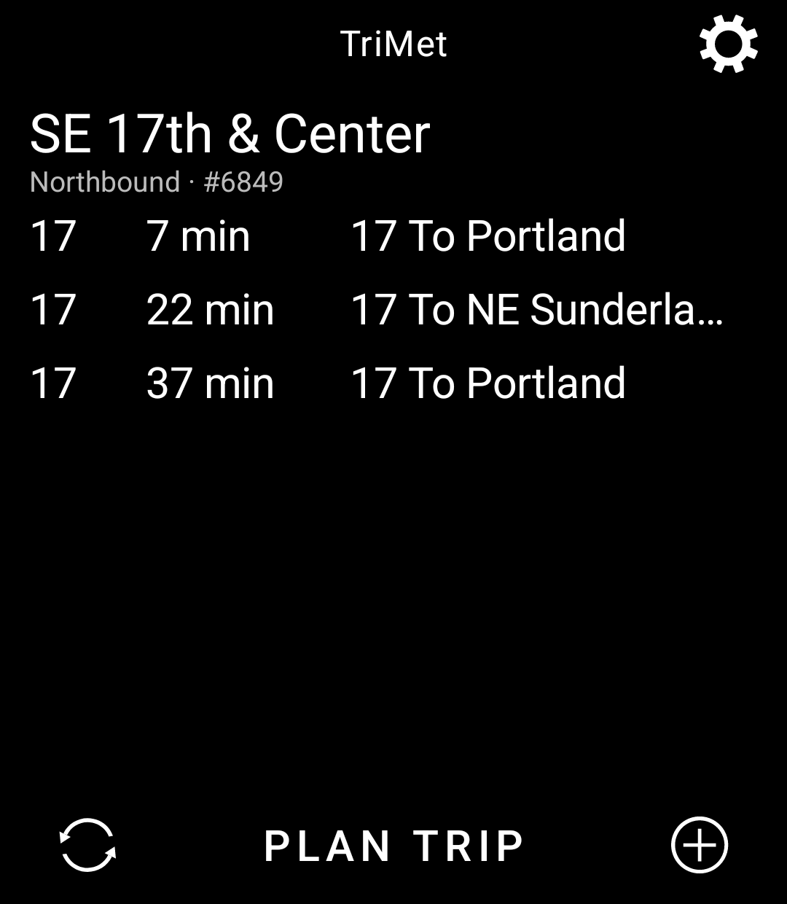
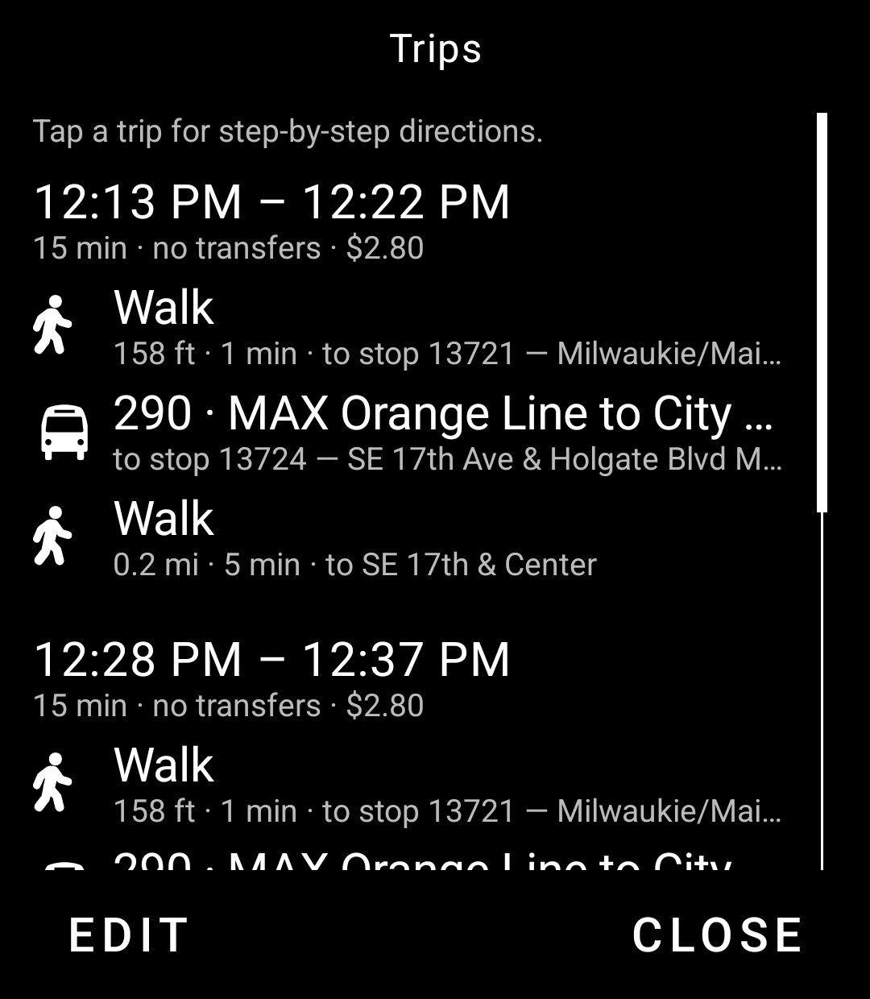
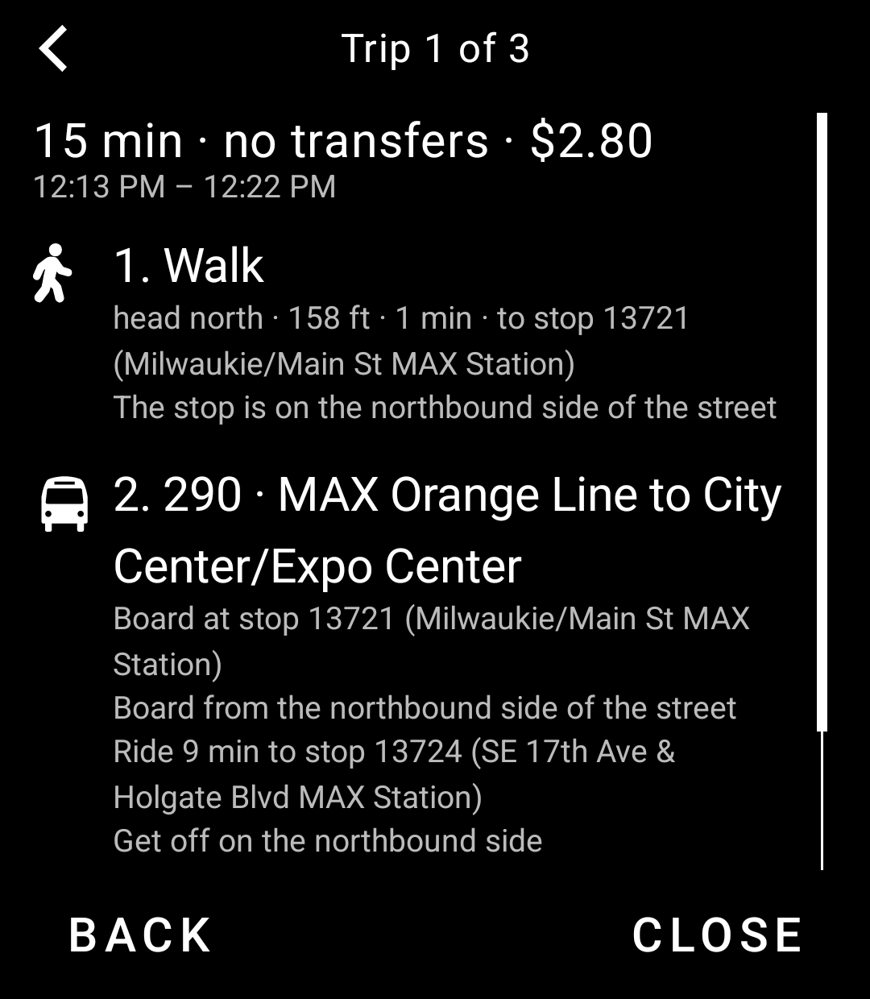

# TriMet — a Light Phone tool

A [Light Phone III](https://thelightphone.com) tool for Portland's [TriMet](https://trimet.org)
transit system. It has two jobs:

- **Live arrivals by stop ID.** Save the stops you use (by their TriMet stop ID) and see upcoming
  arrivals, refreshed about every minute. Each row shows the route, how many minutes away the
  vehicle is (or its scheduled time when no estimate is available), the destination sign, and any
  detour, drop-off-only, or disruption note.
- **Trip planning.** Plan a trip between two places. Enter a numeric stop ID for a saved stop, or
  free text for an address or landmark (TriMet geocodes it). If TriMet can't resolve a place
  cleanly, the tool lists the nearby matches and lets you pick one. Tap a proposed trip for
  step-by-step directions: which stop to walk to, the stop ID to board at, how long to ride, and
  which side of the street each stop is on.

This is an independent project. It is not affiliated with or endorsed by TriMet.

## Screenshots

| Live arrivals | Trip results | Step-by-step directions |
| --- | --- | --- |
|  |  |  |

All data comes from TriMet's public web services ([developer.trimet.org](https://developer.trimet.org/ws_docs/)):
arrivals V2 and the Trip Planner. The registered AppID lives in
[`TriMetApi.kt`](tool/src/main/kotlin/com/tthayer/lighttrimet/TriMetApi.kt); it is a public
application identifier, not a secret.

## Privacy

The tool talks only to `developer.trimet.org`. It sends the stop IDs and place names needed to
answer the request, and nothing else. There is no analytics, no tracking, no advertising, and no
account. Saved stops are stored on the device in Android DataStore and are never uploaded.

## Repository layout

This is a tool-only repository. The only code that ships is [`tool/`](tool); Light's build server
extracts `tool/` from the commit and builds it against a pinned copy of the
[light-sdk](https://github.com/lightphone/light-sdk). Everything else the SDK needs is supplied by
the build server.

```
gradle.properties                  sdkVersion -> selects Light's SDK builder image
tool/
  lighttool.toml                   tool id, label, version, permissions
  build.gradle.kts                 allowed dependencies
  src/main/kotlin/com/tthayer/lighttrimet/
    HomeScreen.kt                  saved stops + live previews (the initial screen)
    StopScreen.kt                  one stop's full arrival board
    TripPlanScreen.kt              trip planner: from/to entry, results, and step-by-step detail
    AddStopScreen.kt               add a stop by ID
    AboutScreen.kt                 attribution
    TriMetApi.kt                   HTTP client for arrivals + trip planner
    TriMetModels.kt                API models and app data types
    TriMetXml.kt                   Trip Planner XML parsing
    TriMetFormatting.kt            time/distance/duration formatting
    SavedStops.kt                  DataStore-backed list of saved stops
    Components.kt                  shared UI rows and icons
  src/test/kotlin/...              unit tests for parsing and formatting
```

## Build and test

Because the repo contains only the tool, build it inside a checkout of the SDK. This replaces the
SDK's sample `tool/` with this one:

```sh
git clone https://github.com/lightphone/light-sdk
cd light-sdk
git checkout v$(grep '^sdkVersion' ../light-trimet/gradle.properties | cut -d= -f2)   # match the pinned SDK
git fetch https://github.com/tthayer/light-trimet main
git checkout FETCH_HEAD -- tool

echo "sdk.dir=$HOME/Library/Android/sdk" > local.properties   # point at your Android SDK
./gradlew :tool:testDebugUnitTest   # unit tests
./gradlew :tool:assembleDebug       # debug APK
./gradlew :tool:lintDebug           # SDK lint rules (restricted APIs, etc.)
```

The debug APK lands at `tool/build/outputs/apk/debug/tool-debug.apk`.

### Run it

Start an Android emulator sized like a Light Phone III (1080 × 1240, Android API 34, no Google Play
Services) and install the APK:

```sh
adb install -r tool/build/outputs/apk/debug/tool-debug.apk
```

That is enough for this tool (arrivals + trip planning over the network). To exercise notification
and permission flows you need LightOS itself; the LightOS emulator app runs as a system app. The
full recipes are in the SDK's [emulator docs](https://github.com/lightphone/light-sdk/tree/main/docs/system_app)
and [sideloading docs](https://github.com/lightphone/light-sdk/tree/main/docs/sideloading).

## Using it

1. On the home screen, tap **+** and enter a stop ID (find it on trimet.org or on the sign at the
   stop). The tool validates the ID and saves the stop.
2. The home screen shows the next few arrivals at each saved stop. Tap a stop for the full board;
   it refreshes every minute or when you tap the refresh icon. The trash button on a stop's board
   removes it (with a confirm step).
3. Tap **PLAN TRIP** (from the home screen, from a stop, or on its own) and fill in **From** and
   **To**. Use a stop ID, or type a place name. Accept the suggested match if TriMet asks which
   place you meant, then tap a trip for step-by-step directions.

## Submitting to the Light Tool Library

The tool is built and signed by Light from a public git commit. To submit:

1. Keep this repository public. `tool/lighttool.toml` carries the metadata the build server and the
   device read:
   - `id = "com.tthayer.lighttrimet"` — globally unique and permanent once published
   - `label = "TriMet"`
   - `versionCode = 2`, `versionName = "0.1.1"`
   - `permissions = ["android.permission.INTERNET"]`
2. Bump `versionCode` (and `versionName`) for every submission; Light rejects a build whose
   `versionCode` does not exceed the last published one.
3. Enable developer mode on the [dashboard](https://dashboard.thelightphone.com/) (Settings →
   Account → Developer Account), register the tool from this repo, and add at least one image.
4. On the tool's page, **submit build** with the git ref to publish (a release tag, e.g. `v0.1.0`)
   and a short changelog.
5. Light reviews the build and e-mails any feedback.

### Releases

Versions are tagged `v<versionName>` and carry a GitHub Release. The tag you hand the dashboard is
the commit that gets built and signed.

- [`v0.1.0`](https://github.com/tthayer/light-trimet/releases/tag/v0.1.0) — first release.

See [`TOOL_GUIDELINES.md`](TOOL_GUIDELINES.md) for the criteria Light reviews against and the
[light-sdk README](https://github.com/lightphone/light-sdk#submitting-your-tool) for the full
submission process.
